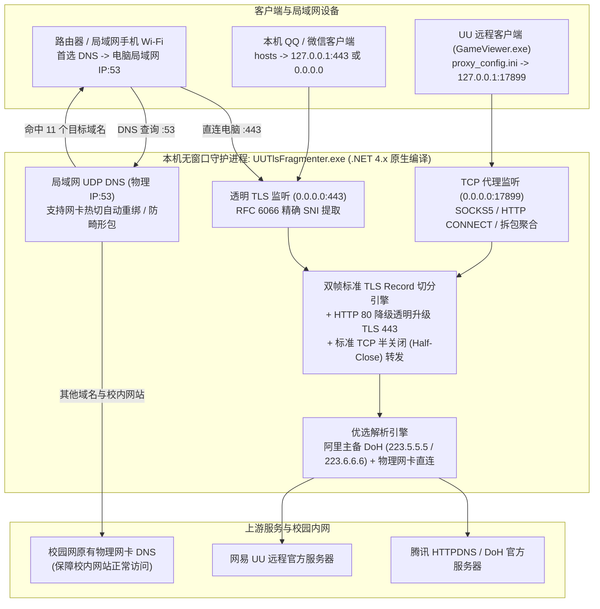

# Campus TLS Fix (UU 远程 & QQ/微信图片加载缓慢修复工具)

<p align="left">
  
  
  
  
</p>

针对部分校园网或局域网出口防火墙对特定域名进行明文 SNI 阻断丢包的问题，提供两套独立运行、免安装 Python、零外部依赖、双击即用的本地修复工具：

1. **网易 UU 远程 (`GameViewer`) TLS 握手阻断修复**：解决 `*.nrd.nie.163.com` 控制与信令域名 TLS `ClientHello` 超时导致无法登录、无法刷新设备列表或无法建立远控的问题。
2. **QQ / 微信图片加载缓慢 (腾讯 HTTPDNS / DoH 阻断) 修复**：解决 `dns.qq.com`、`dns.weixin.qq.com` 等 5 个腾讯自建 HTTPDNS 域名被 SNI 阻断丢包，导致客户端每次加载聊天图片都卡在 TCP/TLS 状态机等待超时后才回退系统 DNS 的问题（支持 **Auto 双模自适应**、**TLS 分片直连放通** 与 **0.0.0.0 快速回退系统 DNS** 模式）。

两个模块分开提供独立的一键修复与恢复入口，互不干扰，可单独使用也可同时开启。

---

## 模块一：修复 UU 远程 TLS 握手阻断

### 方式一：PowerShell 一行命令在线修复

打开 **终端** 或 **Windows PowerShell**，执行以下任意一行命令即可完成本地编译、启动、开机自启、防火墙放行与 6 项握手测速：

- **国内镜像加速通道**：
  ```powershell
  irm https://gh-proxy.com/https://raw.githubusercontent.com/yunyancuo/campus-tls-fix/main/install.ps1 | iex
  ```
- **GitHub 官方通道**：
  ```powershell
  irm https://raw.githubusercontent.com/yunyancuo/campus-tls-fix/main/install.ps1 | iex
  ```

### 方式二：下载压缩包双击修复

1. 点击仓库右上角 `Code` -> `Download ZIP` 并**完整解压**；
2. 双击运行 **`一键修复UU远程.bat`**（支持任意含空格、中文或特殊字符的解压路径）。

### 卸载并恢复 UU 远程默认配置

- **在线卸载**：
  ```powershell
  irm https://gh-proxy.com/https://raw.githubusercontent.com/yunyancuo/campus-tls-fix/main/uninstall.ps1 | iex
  ```
- **本地双击卸载**：双击运行 **`一键卸载恢复.bat`**（或在本地执行 `.\install.ps1 -Uninstall`）。

---

## 模块二：修复 QQ / 微信图片加载缓慢 (腾讯 HTTPDNS 阻断)

### 问题现象与根因

在部分校园网环境下，QQ 与微信聊天窗口加载图片经常需要转圈等待数秒才显示。原因是客户端会优先向腾讯自建的 5 个 HTTPDNS / DoH 域名发起查询：

- `dns.qq.com`
- `dns.weixin.qq.com`
- `dns.weixin.qq.com.cn`
- `httpdns.kg.qq.com`
- `dns.wechat.com`

当校园网出口对这 5 个域名进行 SNI 阻断丢包（不返回 RST，直接丢弃报文）时，客户端会卡在 TCP/TLS 握手状态机直到超时（约 3~5 秒），随后才回落到系统 DNS 加载图片。

### 双模自适应修复机制

- **模式 A：双模自适应（`Auto`，默认推荐）**
  优先启动本地 TLS 分片直连（`Fragment`），并对全部 5 个域名逐一实测；若个别域名在当前网络出口下分片仍超时，脚本会自动将该单个域名精准降级为 `FastFail`（`0.0.0.0` / `::`）、刷新系统 DNS 并复测确认生效；若 443 端口被其他程序占用，自动整体无缝切换为 `FastFail`。
- **模式 B：TLS 分片直连放通（`Fragment`）**
  通过系统 `hosts` 将上述 5 个域名指向 `127.0.0.1`，由本地守护程序 `UUTlsFragmenter.exe`（监听 `443` 端口）按 RFC 6066 精准定位 SNI 扩展，将首个 TLS `ClientHello` 在域名特征关键字中间切分为 2 个标准 TLS Record 帧后直连发出，使腾讯 HTTPDNS 查询在 `100~160 ms` 内正常完成握手。
- **模式 C：快速失败秒回退系统 DNS（`FastFail`）**
  将上述 5 个域名在 `hosts` 中指向 `0.0.0.0`（及 IPv6 `::`），并在局域网 DNS 服务中直接返回 `NXDOMAIN`。客户端发起 HTTPDNS 请求时在 `0~1 ms` 内立即收到失败通知并瞬间回退到系统 DNS，彻底消除状态机超时等待。

### 一键使用方法

- **本地双击修复（推荐）**：解压后直接双击运行 **`一键修复QQ微信图片缓慢.bat`**（自动请求管理员权限，默认 `Auto` 双模自适应并打印 5 个域名的实测耗时）。
- **PowerShell 在线一键修复**：
  ```powershell
  irm https://gh-proxy.com/https://raw.githubusercontent.com/yunyancuo/campus-tls-fix/main/fix-qq-wechat.ps1 | iex
  ```
- **显式指定修复模式**：
  ```powershell
  .\fix-qq-wechat.ps1 -Mode FastFail
  .\fix-qq-wechat.ps1 -Mode Fragment
  ```
- **独立卸载并恢复 QQ / 微信默认配置**：
  双击运行 **`一键恢复QQ微信默认.bat`**，或在管理员 PowerShell 中运行：
  ```powershell
  irm https://gh-proxy.com/https://raw.githubusercontent.com/yunyancuo/campus-tls-fix/main/unfix-qq-wechat.ps1 | iex
  ```

---

## 工作原理架构与局域网/手机共享



### 核心网络特性

- **RFC 6066 精确 SNI 双帧切分**：严格按 TLS 协议二进制结构定位 `server_name` 扩展偏移，精准在核心受阻断后缀中间将首个 `ClientHello` 切分为 2 个合法 TLS Record 帧，避免伪造字节误判并支持 TCP 拆包自动聚合。
- **校园网内网 DNS 动态继承与网卡热切自愈**：局域网 DNS (`:53`) 自动缓存并继承本机物理网卡（以太网 / WLAN）的 IPv4 上游 DNS；当电脑从 Wi-Fi 切换至网线或重新获取 DHCP 地址时，自动感应网络变化并热重绑新局域网 IP，所有上游不可达时返回 `SERVFAIL` 引导客户端秒切备选 DNS。
- **网关智能优选与双 DoH 容灾**：通过阿里公共 DoH 主备节点 (`223.5.5.5` / `223.6.6.6`) 解析支持多帧重组的官方低延迟节点。
- **降级自愈与二进制无损改写**：自动将已降级的 `80` 端口明文请求透明升级为 `443` 加密 TLS 通道，仅改写 HTTP 头部 `Host` 字段并无损保留二进制请求体。
- **TCP 半关闭（Half-Close）安全转发与物理网卡直连**：出站 Socket 自动避开代理软件虚拟网卡（Wintun / TUN / TAP / WSL / VMware / WireGuard 等），直接绑定物理网卡发出，并在单侧 `FIN` 时完整等待尾部响应回传。

### 路由器 / 手机 Wi-Fi 局域网共享配置

如果希望同一路由器下的手机也同步修复 UU 远程和 QQ / 微信图片加载缓慢，同时**不影响手机打开学校内网网站**：

1. 在运行了本工具的电脑上查看本机局域网 IPv4 地址（例如 `192.168.x.x`）；
2. 在路由器后台 DHCP DNS 设置（或手机 Wi-Fi 的手动 DNS 设置）中：
   - **首选 DNS**：填写电脑的局域网 IP（由本机 `:53` 端口拦截被阻断的 11 个域名，其余所有校内网站与普通网站自动转发给电脑网卡上原有的校园网 DNS 解析）；
   - **备选 DNS**：填写学校原本的校园网 DNS（电脑关机或休眠时手机自动回退，不影响正常上网和打开校内网站）。

---

## 安全、备份与回滚机制

- **自动原始备份**：脚本在首次修改系统 `hosts` 或 UU 远程 `proxy_config.ini` 前，会自动在 `%LOCALAPPDATA%\UURemoteTlsFix\backups\` 下保留原始备份文件（`hosts.orig.bak`、`proxy_config.ini.orig.bak`）以及最近一次修改前快照（`*.last.bak`），不会覆盖首次原始备份。
- **互不干扰的独立卸载**：
  - 卸载 UU 远程时，若检测到 QQ/微信分片模式仍处于启用状态，会自动保留守护进程与防火墙放行规则；
  - 卸载 QQ/微信修复时，若检测到 UU 远程仍在启用，也会自动保留守护进程；
  - 当两个模块均已卸载时，自动停止守护进程、移除开机自启项、清理 Windows 防火墙规则（`UURemoteTlsFix-LAN-TCP` / `UURemoteTlsFix-LAN-UDP`）及安装目录。
- **只读 `hosts` 与用户注释保护**：安全兼容被部分安全软件设为只读属性的 `hosts` 文件，清理规则时仅精准移除本工具写入的映射条目，不会误删用户自定义的注释与校园内网映射。

---

## 常见故障排查

| 现象 | 可能原因 | 解决方法 |
| :--- | :--- | :--- |
| 双击 `.bat` 提示找不到 `.ps1` | 仅单独复制了 `.bat` 文件或未解压 ZIP 直接在压缩包内双击 | 将完整 ZIP 压缩包全部解压到普通目录后再双击运行 |
| 写入 `hosts` 失败 / 权限被拒 | 火绒、360、腾讯电脑管家等安全软件拦截了对系统 `hosts` 的修改 | 在安全软件弹窗中选择“允许修改”，或暂时关闭 hosts 保护后重试 |
| 提示本机 `443` 端口被占用 | 本机运行了 IIS、Nginx、Apache、VMware 共享或占用 443 端口的代理软件 | UU 远程使用 `17899` 端口不受影响；QQ/微信修复在 `Auto` 模式下会自动切换为 `FastFail`（`0.0.0.0` 秒回退），无需占用 443 端口 |
| 手机配置电脑 IP 为 DNS 后无响应 | 电脑当前网络配置为“公用网络”且防火墙拦住了入站，或电脑切换网卡后 IP 变化 | 以管理员身份重新运行一次修复脚本自动配置防火墙放行规则，并确认手机所填首选 DNS 与电脑当前局域网 IP 一致 |
| 排查守护进程运行详情 | 需要查看转发、SNI 或 DNS 日志 | 查看日志文件 `%LOCALAPPDATA%\UURemoteTlsFix\uu_tls_fragmenter.log`（超过 2MB 自动滚动备份为 `.log.old`） |

---

## 项目结构

```text
campus-tls-fix/
├── install.ps1                  # UU 远程一键修复主脚本（支持 irm ... | iex 在线执行）
├── uninstall.ps1                # UU 远程一键卸载与恢复脚本
├── 一键修复UU远程.bat            # Windows 双击修复 UU 远程启动器
├── 一键卸载恢复.bat              # Windows 双击卸载 UU 远程启动器
├── fix-qq-wechat.ps1            # QQ/微信图片加载缓慢独立修复脚本（Auto/Fragment/FastFail）
├── unfix-qq-wechat.ps1          # QQ/微信图片加载缓慢独立恢复脚本
├── 一键修复QQ微信图片缓慢.bat    # Windows 双击修复 QQ/微信图片加载缓慢启动器
├── 一键恢复QQ微信默认.bat        # Windows 双击恢复 QQ/微信默认设置启动器
├── src/
│   └── UUTlsFragmenter.cs       # 零依赖原生 C# (.NET Framework 4.x) TLS 分片与局域网 DNS 源码
├── tests/
│   ├── Run-AllTests.ps1         # 自动化测试套件一键入口（纯 127.0.0.1 环回隔离，零宿主机修改）
│   ├── Test-StaticAndBuild.ps1  # AST 语法、BAT CRLF/编码、三处源码同步与 csc.exe 零警告编译测试
│   ├── Test-CoreUnitAndLoopback.ps1 # TLS/DNS 单元测试与全链路环回 TCP/UDP 集成测试
│   └── Sync-EmbeddedSource.ps1  # 将 src/UUTlsFragmenter.cs 同步嵌入在线脚本的维护工具
├── .github/
│   └── workflows/
│       └── ci.yml               # GitHub Actions Windows CI（编译、测试与 PSScriptAnalyzer）
├── .gitattributes               # Git 行尾配置（强制 .bat/.ps1/.cs 使用 CRLF 换行）
├── .gitignore                   # Git 忽略规则配置
├── LICENSE                      # MIT 开源许可证
└── README.md                    # 项目说明文档
```

---

## 覆盖端点与实测表现

| 所属服务 | 域名端点 | 作用 | 修复前状态 | 修复后状态（本机分片直连） |
| :--- | :--- | :--- | :---: | :---: |
| **UU 远程** | `api.nrd.nie.163.com` | 核心控制与房间 API | TLS 握手超时 | 握手成功 (`~60-110 ms`) |
| **UU 远程** | `api-dcdn.nrd.nie.163.com` | DCDN 灾备控制 API | TLS 握手超时 | 握手成功 (`~90-120 ms`) |
| **UU 远程** | `api-event.nrd.nie.163.com` | 客户端事件上报 API | TLS 握手超时 | 握手成功 (`~60-85 ms`) |
| **UU 远程** | `api-ipv4.nrd.nie.163.com` | IPv4 远程唤醒与初始化 | TLS 握手超时 | 握手成功 (`~60-80 ms`) |
| **UU 远程** | `sig-3303-d.nrd.nie.163.com` | WebSocket 远程控制信令 | TLS 握手超时 | 握手成功 (`~300-550 ms`) |
| **UU 远程** | `relay-mg-3303-d.nrd.nie.163.com` | TURN/TLS 桌面画面流中继 | TLS 握手超时 | 握手成功 (`~40-90 ms`) |
| **QQ / 微信** | `dns.qq.com` | 腾讯公共/客户端 DoH & HTTPDNS | TLS 握手超时 (`>3000 ms`) | 握手成功 (`~60-130 ms`) / 秒回退 (`<1 ms`) |
| **QQ / 微信** | `dns.weixin.qq.com` | 微信客户端主 HTTPDNS | TLS 握手超时 (`>3000 ms`) | 握手成功 (`~110-160 ms`) / 秒回退 (`<1 ms`) |
| **QQ / 微信** | `dns.weixin.qq.com.cn` | 微信国内节点 HTTPDNS | TLS 握手超时 (`>3000 ms`) | 握手成功 (`~60-130 ms`) / 秒回退 (`<1 ms`) |
| **QQ / 微信** | `httpdns.kg.qq.com` | 腾讯多媒体/图片 HTTPDNS | TLS 握手超时 (`>3000 ms`) | 握手成功 (`~65-140 ms`) / 秒回退 (`<1 ms`) |
| **QQ / 微信** | `dns.wechat.com` | WeChat 国际/通用 HTTPDNS | TLS 握手超时 (`>3000 ms`) | 握手成功 (`~350-1300 ms`) / 秒回退 (`<1 ms`) |

---

## 开发与本地测试指南

所有测试均在用户态 `127.0.0.1` 随机空闲端口与临时沙盒目录中隔离运行，**不会修改宿主机的 DNS、hosts、防火墙或网卡配置**。

1. **运行全量自动化测试（Windows PowerShell 5.1+）**：
   ```powershell
   powershell -NoProfile -ExecutionPolicy Bypass -File .\tests\Run-AllTests.ps1
   ```
2. **修改 `src/UUTlsFragmenter.cs` 后同步在线单文件脚本**：
   为保证 `irm ... | iex` 单脚本在线执行始终与仓库核心源码一致，修改 `src/UUTlsFragmenter.cs` 后请执行：
   ```powershell
   powershell -NoProfile -ExecutionPolicy Bypass -File .\tests\Sync-EmbeddedSource.ps1
   ```
3. **代码风格与兼容性红线**：
   - `src/UUTlsFragmenter.cs` 必须保持纯 `.NET Framework 4.x` / C# 5.0 语法兼容，且通过系统自带 `csc.exe /warn:4 /warnaserror+` 零警告编译；
   - 所有 `.bat` 文件必须保持 **UTF-8 无 BOM + CRLF** 换行；
   - 所有 `.ps1` 文件必须保持 **UTF-8 with BOM + CRLF** 换行以兼容 Windows PowerShell 5.1 中文解析。

---

## License

本项目基于 [MIT License](./LICENSE) 开源。
